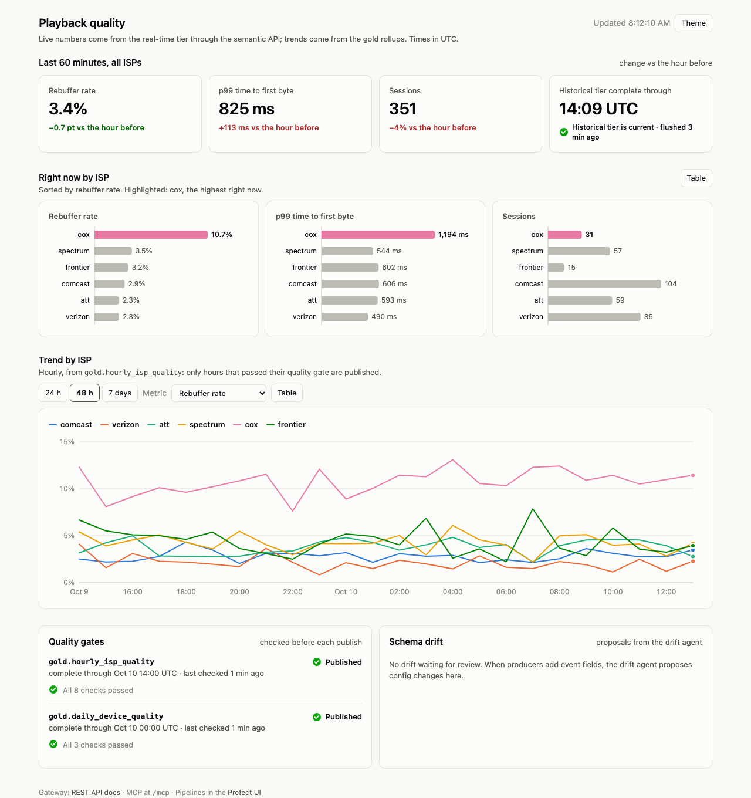

# Agentic Lakehouse

[](https://github.com/Jeff-VA/agentic-lakehouse/actions/workflows/ci.yml)

A config-driven semantic lakehouse. You define metrics once, in YAML. The
engine answers them from **Apache Pinot** (real-time) and **Apache Iceberg via
Trino** (historical), splitting and merging a query across the two when it
spans both, and serves the answers to dashboards and AI agents over **REST**
and **MCP**. Events arrive through **Kafka**, land in Iceberg exactly once,
and are rolled up into gold tables behind **data quality gates**. When
producers change their events, a **Claude-powered agent** proposes the
ontology changes as a reviewable patch.



**See it on live data:** [wiki-pulse](https://github.com/Jeff-VA/wiki-pulse) is
a project built on this engine. It covers every edit to every Wikipedia, as
it happens. A stream processor flags articles getting far more edits than
usual, and Claude explains them. A classifier trained on Claude's labels
scores every burst. The results show in three live dashboards.

## Highlights

- **One ontology, three engines.** Dimensions and metrics are defined once in
  [`config/ontology.yaml`](config/ontology.yaml). A dbt-style Jinja compiler
  turns them into DuckDB, Trino or Pinot SQL. sqlglot parses every hand-written
  SQL fragment at load time, so a broken definition fails when the config
  loads, not in a query.
- **A router that knows where data lives.** Recent ranges go to Pinot, older
  ones to Trino, and a range that spans both is split and merged in DuckDB.
  Every answer reports the time range it actually covers.
- **Exactly-once ingestion with schema evolution.** The flush stores its Kafka
  offsets in the same Iceberg commit as the rows. New event fields become new
  columns without anyone touching config.
- **Rollups behind quality gates.** Gold tables are materialized semantic
  queries. Their new rows must pass checks before they're published
  (write-audit-publish); otherwise the table keeps its last good contents.
- **Live feeds, stream processors and pipeline steps.** A dataset can come
  from a public feed the platform reads itself, or be computed from another
  dataset as it streams; SQL or Python steps build tables in dependency order,
  behind quality checks. Models live in the lakehouse as tables, so training,
  real-time scoring and dashboards share one source of truth.
- **An agent for schema drift.** When new fields appear, Claude proposes
  dimensions and metrics. A proposal has to pass the platform's own validation
  and run on real data before it is written as a git patch for a person to
  review.
- **Views in plain SQL.** Dashboards read named, parameterized views from
  `config/views/*.sql`. A view over an ontology model selects metrics by name
  and is routed across both tiers, so it is live to the second; a view over
  Iceberg tables is ordinary Trino SQL. Every view is checked against the
  config when it loads, so renaming a metric fails a test, not a dashboard.
- **Dashboards are HTML with live chart tags.** `<al-lines view="isp_hourly"
  x="hour" y="p99_ttfb" series="isp_provider">` draws a view and keeps it
  current: the server pushes a new result when the data changes, and everyone
  watching the same view shares one query. Labels and number formats come from
  the ontology, so the example dashboard is about 90 lines of HTML.
- **The same answers for people and agents.** A REST API, an MCP server for
  Claude Code or Claude Desktop, and a dashboard all go through one gateway, so
  they report the same numbers with the same caveats.

## Architecture


Events land in two tiers: Pinot keeps the last 7 days, and Iceberg keeps all
of history. Every question, from a dashboard, an app or an AI agent, goes
through the gateway, which compiles it from the config, sends each part of the
time range to the tier that holds it, and says what the answer covers.
[`docs/architecture.md`](docs/architecture.md) walks through each part with a
diagram: data in, a question answered, which tier answers, and a view becoming
a live page.

## Quick start

You need Docker with about 12 GB of memory for its VM and about 8 GB of disk
for images. On macOS, for example:
`colima start --cpu 6 --memory 12 --disk 30`.

```bash
docker compose -f docker/docker-compose.yml up -d --build
```

The first start takes a few minutes. Once the engines are healthy, `setup`
creates the topics and tables and publishes 24 hours of synthetic playback
telemetry, and a live stream keeps the data moving after that. The flush
moves events into Iceberg every 5 minutes, and the rollups follow within
another 5. From an empty machine, the API is up in about a minute.

| | |
|---|---|
| Dashboard | http://127.0.0.1:8000 |
| REST API docs | http://127.0.0.1:8000/docs |
| Prefect UI (pipelines, quality-gate results) | http://127.0.0.1:4200 |
| Pinot UI · Trino · MinIO console | http://127.0.0.1:9000 · `127.0.0.1:8080` · http://127.0.0.1:9101 |

**Ask questions from Claude Code.** The gateway is an MCP server:

```bash
claude mcp add --transport http lakehouse http://127.0.0.1:8000/mcp
```

Then ask something like *"Which ISP had the worst rebuffering over the last 6
hours, and can I trust the data right now?"* The agent can list the metrics
(`list_metrics`), query them (`query_metrics`), run the project's views
(`list_views`, `query_view`) and check freshness and quality gates
(`data_status`).

**Build dashboards with Claude Code.** Open the repository in Claude Code:
[`.mcp.json`](.mcp.json) registers the platform's MCP server on your machine
(`agentic-lakehouse mcp`), and [`AGENTS.md`](AGENTS.md) gives it the workflow.
Ask for a dashboard. The agent writes views and a page, checks them
(`check_dashboards`), and looks at the result (`screenshot_dashboard`: headless
Chrome, live data). Any page you have open reloads each time it saves a file.
The `build_dashboard` prompt starts the same loop in any MCP client.

**Watch the drift agent.** Put `ANTHROPIC_API_KEY=...` in a `.env` file at the
repository root (it is git-ignored) and restart the `drift` service. Then
simulate an upstream release that adds two event fields:

```bash
docker compose -f docker/docker-compose.yml stop stream
docker compose -f docker/docker-compose.yml run --rm stream stream --add-field cdn_pop=string --add-field dropped_frames=double
```

Within one flush the fields become Iceberg columns. The next drift check, or
`docker compose -f docker/docker-compose.yml exec drift agentic-lakehouse drift`,
writes a proposal that the dashboard lists. Apply it with
`git apply proposals/<file> && agentic-lakehouse setup`.

## Start your own project

Install the engine and create a project in a folder of its own:

```bash
pip install "agentic-lakehouse @ git+https://github.com/Jeff-VA/agentic-lakehouse@v0.4.0"
agentic-lakehouse init my-project
cd my-project
python3 -m venv .venv && .venv/bin/pip install -r requirements.txt pytest
docker compose -f docker/docker-compose.yml up -d --build
```

The new folder is a working project, pinned to the engine release it came
from: a starter dataset with metrics, views, a rollup behind quality checks
and a dashboard, plus its own Docker stack, CI, tests and agent files
(`AGENTS.md`, `.mcp.json`). Then make it yours:

1. **Describe your events** in `config/ingestion.yaml`: a Kafka topic, columns
   and a time column per dataset.
2. **Define your metrics and dimensions** in `config/ontology.yaml`. They are
   YAML; you only write SQL for small expressions, like a `CASE` that turns a
   device name into a mobile flag.
3. **Add views and dashboards** in `config/views/` and `config/dashboards/`,
   and rollups and their checks in `config/storage.yaml` and
   `config/quality_rules.yaml`. With Claude Code, ask for a dashboard: the
   project's `AGENTS.md` and MCP tools give it the workflow.
4. **Run it** with the command above. Setup creates the topics and tables, then
   publishes synthetic events with random values that fit your columns until
   your real producers write to Kafka. For realistic fake data, point the
   dataset's `simulator` at a function of your own: the command imports your
   project's modules from the folder it runs in.

A project's tests use `agentic_lakehouse.testing`, which runs every view and
dashboard on DuckDB stand-ins for the stack, so they need no Docker and run in
CI. To upgrade the engine, change the version in `requirements.txt`.

This repository works the same way: `config/` is a project (a copy of
[`examples/playback/`](examples/playback/), which the tests use), and
`agentic_lakehouse/` is the engine, which knows nothing about playback data.
Each release also publishes the app image, `ghcr.io/jeff-va/agentic-lakehouse`.

## Endpoints

With the stack up, the gateway answers on `http://127.0.0.1:8000` (and so
does `agentic-lakehouse serve`). It has no authentication yet, so keep it on a
trusted network (see [Limitations](#limitations)). Times are UTC, in ISO 8601.
`/docs` is an interactive reference, and `/openapi.json` its OpenAPI schema.
The examples use the example project's metrics and views.

| Endpoint | Use it to |
|---|---|
| `GET /health` | check that the gateway is up |
| `GET /catalog` | see the metrics and dimensions you can ask for |
| `POST /query` | ask for metrics over a time range |
| `GET /views` | see the project's views: parameters, columns, SQL |
| `GET /views/{name}` | run a view, as JSON, CSV or Parquet |
| `GET /views/{name}/live` | follow a view as it changes (Server-Sent Events) |
| `GET /live` | follow several views over one connection, as dashboards do |
| `GET /sql`, `POST /sql` | run SQL over models and tables without saving a view |
| `GET /status` | see how fresh the data is, the quality gates, and schema drift |
| `GET /rollups/{table}` | read a gold table's recent rows |
| `GET /d/{name}`, `GET /` | open a dashboard |
| `GET /al.js` | draw views in your own pages |
| `/mcp` | connect an AI agent (Model Context Protocol) |
| Kafka, `127.0.0.1:9092` | send your events |

### GET /health

Answers without touching the engines: for container healthchecks and load
balancers.

```bash
curl http://127.0.0.1:8000/health    # {"status":"ok"}
```

### GET /catalog

Every model's metrics and dimensions: what each means (`description`), how
it's computed (`calculation`), how to show it (`label`, `format`, `unit`,
`better`), and how far each tier reaches. Read it before asking for anything.

```bash
curl http://127.0.0.1:8000/catalog
```

```json
{
  "now": "2026-10-12T00:13:40Z",
  "models": [{
    "name": "playback_telemetry",
    "time_dimension": "event_ts",
    "grains": ["minute", "hour", "day", "week", "month"],
    "realtime_days": 7.0,
    "historical_through": "2026-10-12T00:12:26Z",
    "dimensions": [{"name": "isp_provider", "type": "string", "label": "ISP", "description": ""}],
    "metrics": [{
      "name": "p99_ttfb",
      "description": "99th percentile Time-to-First-Byte latency (ms), measured on stream starts.",
      "calculation": "0.99 quantile of request_latency_ms (approximate on Trino and Pinot) where stream_start_event = true",
      "label": "p99 time to first byte", "format": "integer", "unit": "ms", "better": "lower"
    }]
  }]
}
```

### POST /query

Metrics over a time range, grouped by dimensions. The gateway picks the tier,
or both, and reports what the answer covers.

| Field | |
|---|---|
| `metrics` | required: metric names from `/catalog`, all from one model |
| `start`, `end` | required: the range `[start, end)` in ISO 8601; no offset means UTC |
| `dimensions` | group by these |
| `grain` | also group by time: `minute`, `hour`, `day`, `week` or `month` |
| `filters` | `[{"dimension": "isp_provider", "op": "in", "value": ["cox", "att"]}]`; `op` is `=`, `!=`, `<`, `<=`, `>`, `>=`, `in` or `not_in` |
| `order_by` | `[{"field": "unique_sessions", "descending": true}]`; the default is time, then dimensions |
| `limit` | at most this many rows; a response never holds more than 5,000 |

Add `?include_sql=true` to see the SQL each engine ran.

```bash
curl -X POST http://127.0.0.1:8000/query -H 'Content-Type: application/json' -d '{
  "metrics": ["rebuffer_incidence_rate", "unique_sessions"],
  "dimensions": ["isp_provider"],
  "start": "2026-10-11T23:00:00Z",
  "end": "2026-10-12T00:00:00Z",
  "order_by": [{"field": "rebuffer_incidence_rate", "descending": true}],
  "limit": 2
}'
```

```json
{
  "columns": [
    {"name": "isp_provider", "role": "dimension"},
    {"name": "rebuffer_incidence_rate", "role": "metric"},
    {"name": "unique_sessions", "role": "metric"}
  ],
  "rows": [
    {"isp_provider": "cox", "rebuffer_incidence_rate": 0.119, "unique_sessions": 41},
    {"isp_provider": "frontier", "rebuffer_incidence_rate": 0.064, "unique_sessions": 24}
  ],
  "coverage": {"start": "2026-10-11T23:00:00Z", "end": "2026-10-12T00:00:00Z"},
  "notes": [],
  "truncated": false,
  "sql": null
}
```

`coverage` can be narrower than the range you asked for, and `notes` say why:
a percentile over both tiers, for example, stops at the last flush. A `400`
names what doesn't exist and lists what does (`unknown metrics: p99.
Available: ...`), a `422` is a malformed request (`start must be before end`),
and a `502` means an engine failed.

### GET /views

The project's views (`config/views/*.sql`): each one's `description`, what it
reads (`source` is `model` for a live view routed across both tiers, `tables`
for SQL on Trino), its `params` with type, default and limits, its result
`columns` with labels and formats, and its `sql`.

```bash
curl http://127.0.0.1:8000/views
```

### GET /views/{name}

Runs a view. Its parameters go in the query string, and any you leave out take
their defaults.

```bash
curl "http://127.0.0.1:8000/views/isp_now?minutes=30"
```

```json
{
  "view": "isp_now",
  "params": {"minutes": 30},
  "columns": [
    {"name": "isp_provider", "type": "string", "label": "ISP", "role": "dimension", "format": null, "unit": "", "better": null, "grain": null},
    {"name": "rebuffer_incidence_rate", "type": "number", "label": "Rebuffer rate", "role": "metric", "format": "percent", "unit": "", "better": "lower", "grain": null}
  ],
  "rows": [{"isp_provider": "cox", "rebuffer_incidence_rate": 0.121, "p99_ttfb": 970.0, "unique_sessions": 26}],
  "coverage": {"start": "2026-10-11T23:44:50Z", "end": "2026-10-12T00:14:50Z"},
  "data_through": null,
  "notes": [],
  "truncated": false,
  "computed_at": "2026-10-12T00:14:50Z",
  "sql": null
}
```

(Columns and rows shortened.) A view over a model reports `coverage`, as
`/query` does. A view over tables reports `data_through` instead: its tables
hold every row before that time, which is their last flush or rollup run. Add
`?include_sql=true` to see the SQL. A `404` means there's no such view, a `400`
a parameter the view doesn't take or a value it doesn't accept
(`parameter 'minutes' must be a whole number, not 'abc'`), and a `502` that an
engine failed.

Add `format=csv` or `format=parquet` to get the rows as a file, for SQL
clients such as DuckDB. A file holds up to 100,000 rows, where JSON holds
5,000, and it keeps its columns when there are no rows: CSV always has its
header row, and Parquet's columns are typed from the view's. CSV writes times
in ISO 8601 UTC (`2026-10-12T00:00:00Z`). With `errors=inline`, a file request
that fails still answers `200`, with one row in one column, `error`, holding
the message: a SQL client shows it, where it would show a bare `HTTP 400`.
JSON always answers with the status code.

```sql
-- DuckDB, with its httpfs extension
SELECT * FROM read_parquet('http://127.0.0.1:8000/views/isp_now?format=parquet&errors=inline&minutes=30');
```

`HEAD` answers with the status and content type `GET` would, without running
the view, so DuckDB needs no `SET force_download = true`.

### GET /views/{name}/live

The same result as a Server-Sent Events stream: a `result` event now, and
another each time the result changes. An `error` event means a refresh failed;
the last result still stands, and the feed keeps trying. A view over a model
reruns every 10 seconds (or every `refresh_seconds` its header sets), and a
view over tables reruns when one of its tables changes.

```bash
curl -N "http://127.0.0.1:8000/views/isp_now/live?minutes=30"
```

```text
event: result
data: {"view":"isp_now","params":{"minutes":30},"columns":[...],"rows":[...],...}
```

In a browser:

```js
const source = new EventSource("/views/isp_now/live?minutes=30");
source.addEventListener("result", event => draw(JSON.parse(event.data)));
source.addEventListener("error", event => {
  if (event.data) warn(JSON.parse(event.data).detail);  // without data, the connection dropped; it reconnects
});
```

### GET /live

Several views over one connection, which is what dashboards use: browsers keep
only about six connections open to a server. Repeat `view` for each one: a
view's name, with its parameters after a `?`, URL-encoded. Each event's
`subscription` is the `view` value exactly as you sent it.

```bash
curl -N "http://127.0.0.1:8000/live?view=quality_overall&view=isp_hourly%3Fhours%3D24"
```

```text
event: hello
data: {"boot": "b3092bec5a324a42b11ec8110d1da522"}

event: result
data: {"subscription": "quality_overall", "result": {"view": "quality_overall", ...}}

event: result
data: {"subscription": "isp_hourly?hours=24", "result": {"view": "isp_hourly", ...}}
```

| Event | Data | Means |
|---|---|---|
| `hello` | `{"boot"}` | first on every connection; a `boot` different from last time means the server restarted, so reload |
| `result` | `{"subscription", "result"}` | a view's new result |
| `error` | `{"subscription", "detail"}` | a view's refresh failed; its last result stands |
| `reload` | `{}` | a view or dashboard file changed |
| `problem` | `{"detail"}` | an edit broke a view; the server keeps the last good version |

```js
const views = new URLSearchParams([["view", "quality_overall"], ["view", "isp_hourly?hours=24"]]);
const source = new EventSource(`/live?${views}`);
source.addEventListener("result", event => {
  const { subscription, result } = JSON.parse(event.data);
  draw(subscription, result);
});
source.addEventListener("reload", () => location.reload());
```

`/al.js` does all of this for dashboards.

### GET and POST /sql

SQL without a view file. It runs the way a view does (see [Views](#views)),
with the same checks and the same result: read a model by name to get its
metrics live across both tiers, or tables as `namespace.table` with any Trino
SELECT. `GET` takes the SQL URL-encoded in `q`, for clients that can only
`GET`, such as DuckDB. `POST` takes it in a JSON body.

```bash
curl -G http://127.0.0.1:8000/sql --data-urlencode "q=SELECT isp_provider, rebuffer_incidence_rate
  FROM playback_telemetry WHERE event_ts >= now() - INTERVAL '1' HOUR"
```

```bash
curl -X POST http://127.0.0.1:8000/sql -H 'Content-Type: application/json' -d '{
  "sql": "SELECT isp_provider, max(p99_ttfb) AS worst_p99 FROM gold.hourly_isp_quality GROUP BY isp_provider"
}'
```

The result is a view's, with `view` set to `sql`. `format`, `errors` and
`include_sql` work as on `GET /views/{name}`, and go in the query string with
`POST` too. To use parameters, start the SQL with a view's header comment
(`description` and `params`), and give their values in the query string, or in
the body's `params` with `POST`. A `400` says what to fix in the SQL.

```sql
-- DuckDB, with its httpfs extension; url_encode is built in
SELECT * FROM read_parquet('http://127.0.0.1:8000/sql?format=parquet&errors=inline&q='
  || url_encode('SELECT isp_provider, p99_ttfb FROM playback_telemetry WHERE event_ts >= now() - INTERVAL ''1'' HOUR'));
```

The SQL may also be a composed view's: parts in a `WITH` clause, then any SQL
over them (see [Views](#views)). `agentic-lakehouse duckdb` sets DuckDB up
with macros for all of this: see [SQL access](#sql-access-duckdb-and-dbeaver).

### GET /status

Whether the data can be trusted right now. For each dataset:
`historical_through` (the flush watermark) and `unmodeled_columns` (fields the
config doesn't describe yet). For each rollup: `complete_through` and
`last_audit` (every check, and whether the run published or was blocked). For
each pipeline step: its `last_run`, likewise. Then the drift proposals waiting
for review.

```bash
curl http://127.0.0.1:8000/status
```

```json
{
  "now": "2026-10-12T00:15:05Z",
  "datasets": [{
    "name": "telemetry", "realtime_days": 7.0,
    "historical_through": "2026-10-12T00:12:40Z",
    "unmodeled_columns": ["cdn_pop", "dropped_frames"]
  }],
  "rollups": [{
    "table": "gold.hourly_isp_quality", "grain": "hour",
    "complete_through": "2026-10-12T00:00:00Z",
    "last_audit": {
      "at": "2026-10-12T00:14:29Z", "published": true,
      "start": "2026-10-10T15:00:00Z", "end": "2026-10-12T00:00:00Z",
      "checks": [{"check": "row_count(min=1, max=-)", "severity": "error", "passed": true, "detail": "198 rows"}]
    }
  }],
  "drift_proposals": []
}
```

(Shortened.)

### GET /rollups/{table}

A gold table's rows from the last `hours` (default 48), oldest first: a quick
read without writing a view. A `404` means the table isn't a rollup in
`storage.yaml`.

```bash
curl "http://127.0.0.1:8000/rollups/gold.hourly_isp_quality?hours=2"
```

### GET /d/{name} and GET /

Dashboards: `config/dashboards/playback.html` is served at `/d/playback`. `/`
opens the only dashboard, or lists them all when there are several. Open pages
reload on their own when a view or dashboard file changes.

### GET /al.js

The chart tags dashboards are written in (see [Dashboards](#dashboards)).
Other pages the gateway serves can use them too. The gateway sends no CORS
headers, so a page from another origin needs a proxy in front of the gateway.

```html
<script type="module">
  import { subscribe } from "/al.js";
  const stop = subscribe("isp_now", { minutes: 30 }, (result, error) => {
    // called now and on every change, like the tags
  });
</script>
```

### /mcp

The Model Context Protocol over Streamable HTTP, for AI agents:

```bash
claude mcp add --transport http lakehouse http://127.0.0.1:8000/mcp
```

The same server runs over stdio on your machine with `agentic-lakehouse mcp`,
which is what [`.mcp.json`](.mcp.json) sets up for Claude Code. Its tools:

| Tool | Arguments | Returns |
|---|---|---|
| `list_metrics` | | the catalog, as `GET /catalog` |
| `query_metrics` | `metrics`, `start`, `end`; optional `dimensions`, `grain`, `filters`, `order_by`, `limit`, `include_sql` | as `POST /query` |
| `data_status` | | as `GET /status` |
| `list_views` | | as `GET /views` |
| `query_view` | `name`; optional `params`, `include_sql` | as `GET /views/{name}` |
| `query_sql` | `sql`; optional `include_sql` | as `GET /sql` |
| `check_dashboards` | | config errors, and each dashboard's problems by file and line |
| `screenshot_dashboard` | `name`; optional `theme`, `width` | a PNG of the page with live data, and the problems it shows |

The prompt `build_dashboard` (argument `goal`) gives an agent the
dashboard-building workflow and the tag reference. `screenshot_dashboard`
needs Chrome where the server runs, and the app's image has none: use the
stdio server on your machine for it.

### Sending events

Producers write to Kafka: `127.0.0.1:9092` from your machine, or
`kafka:19092` from containers on the stack's network. Each message is one
event as a JSON object, on its dataset's `topic` from `ingestion.yaml`, with
keys named after the dataset's columns and timestamps in epoch milliseconds
(UTC). Pinot has the event within seconds; the flush moves it into Iceberg
within 5 minutes.

```python
import json
import time

from confluent_kafka import Producer  # a dependency of this project

producer = Producer({"bootstrap.servers": "127.0.0.1:9092"})
event = {
    "event_ts": int(time.time() * 1000),
    "session_id": "4f1c0a9e2b7d3c18",
    "client_isp": "comcast",
    "client_device": "smart_tv",
    "request_latency_ms": 142,
    "stream_start_event": True,
    "buffer_duration_ms": 0,
    "bitrate_kbps": 11800,
}
producer.produce("playback-telemetry", json.dumps(event).encode())
producer.flush()
```

A missing field is stored as null. A field the config doesn't describe is kept:
it becomes a new Iceberg column, and the drift agent proposes how to model it.

### The engines' own endpoints

The stack also exposes each engine directly, for inspection and ad hoc work.
For metrics, go through the gateway: it applies the metric definitions, routes
across the tiers, and reports what each answer covers. The local credentials
are in [`config/deployment.yaml`](config/deployment.yaml).

| Service | Address | Use it for |
|---|---|---|
| Trino | `127.0.0.1:8080`, catalog `iceberg` | SQL over Iceberg, e.g. `SELECT * FROM iceberg.gold.hourly_isp_quality` |
| Pinot | controller UI `http://127.0.0.1:9000`, broker `127.0.0.1:8099` | the real-time tables |
| Iceberg REST catalog | `http://127.0.0.1:8181` | PyIceberg, Spark and other Iceberg clients |
| MinIO | S3 API `http://127.0.0.1:9100`, console `http://127.0.0.1:9101` | the warehouse's files |
| Prefect | `http://127.0.0.1:4200` | pipeline runs and their logs |

## How it works

### One definition, many engines

A metric is declared once:

```yaml
- name: p99_ttfb
  description: 99th percentile Time-to-First-Byte latency (ms), measured on stream starts.
  agg: percentile
  percentile: 0.99
  sql: request_latency_ms
  filters:
    - "stream_start_event = true"
```

and compiled for each engine. Each engine's dialect lives in one Jinja macro
file ([`agentic_lakehouse/templates/macros/`](agentic_lakehouse/templates/macros/)) that overrides only
what differs from standard SQL:

```sql
-- DuckDB
quantile_cont(request_latency_ms, 0.99) FILTER (WHERE stream_start_event = TRUE)
-- Trino
approx_percentile(CAST(request_latency_ms AS DOUBLE), 0.99) FILTER (WHERE stream_start_event = TRUE)
-- Pinot
PERCENTILETDIGEST("request_latency_ms", 99) FILTER (WHERE "stream_start_event" = TRUE)
```

Hand-written SQL in the ontology is parsed with sqlglot and printed in each
engine's syntax. Fragments that would behave differently across engines are
rejected, for example integer division (`//`), which DuckDB truncates and
Trino rounds. Filter values sent by clients are built as escaped literals,
never pasted into SQL as text.

### Routing across tiers

Pinot keeps the last 7 days. Iceberg holds everything up to the flush
**watermark**, which the flush records in the same commit as the data.

| The query's time range | Answered by |
|---|---|
| inside Pinot's retention | Pinot |
| ends before the watermark | Trino over Iceberg |
| spans both, with a time grain | split at a bucket boundary: each bucket comes from one tier, so every metric is exact |
| spans both, only counts / sums / averages / ratios | each tier returns partial aggregates (an average becomes a sum and a count), merged in DuckDB |
| spans both, with percentiles or distinct counts | Trino up to the watermark, with a note in the result that the newest data isn't included |

Results always carry the range they cover, the SQL each tier ran, and notes,
so neither a person nor an agent mistakes a partial answer for a complete one.

### Ingestion: exactly once, schema-tolerant

[`agentic_lakehouse/flush.py`](agentic_lakehouse/flush.py) reads every message published before it
started and appends the events to Iceberg. The same Iceberg commit records the
Kafka offsets it read up to and the new watermark, so a crash can neither load
a batch twice nor skip one. A new field becomes an optional column with an
inferred type; a field that stops arriving is stored as NULL, in Iceberg and in
Pinot alike.

### Rollups and quality gates

A rollup ([`config/storage.yaml`](config/storage.yaml)) is a semantic query
kept as a gold Iceberg table. Each run recomputes a window that ends at the
last complete time bucket before the watermark and starts where the previous
run stopped, reaching at least `lookback_hours` back so late events are
recounted. The new rows are checked against
[`config/quality_rules.yaml`](config/quality_rules.yaml) before they're
published: `row_count`, `not_null`, `unique`, `range`, `accepted_values`,
`expression` and `freshness`. An `error` check that fails blocks the publish;
a `warn` check is only reported. Results appear on the dashboard, in
`data_status`, and in the Prefect UI.

### Live feeds, processors and pipeline steps

Three ways to make data beyond what producers write to Kafka, each a little
config plus a function in your project's own code:

- **A live feed** (`source` on a dataset in `ingestion.yaml`) is read by
  `agentic-lakehouse ingest`: Server-Sent Events, reshaped by your `transform`,
  checked against the dataset's columns, and published to Kafka. Each message
  keeps the feed's event id, so a restarted ingest resumes after the last event
  it published.

  ```yaml
  - name: edits
    topic: wikipedia-edits
    source:
      kind: sse
      url: https://stream.wikimedia.org/v2/stream/recentchange
      transform: wiki_pulse.edits:from_recentchange  # a feed event -> an edit, or None to leave it out
  ```

- **A processor** (`processor` on a dataset) makes the dataset from another as
  it streams: `agentic-lakehouse process` hands your class the input in
  batches, and what it returns is published as this dataset's events, in Pinot
  within seconds. It keeps state in memory; after a restart it replays
  `warmup_minutes` of input to rebuild it, without publishing anything twice.
- **Steps** ([`pipelines.yaml`](agentic_lakehouse/steps.py)) are SQL or Python
  that each write one Iceberg table, run in the order their reads require,
  behind the table's quality checks. A step that trains a model writes the
  model's parameters as a table, which a processor or a view then reads, so
  there's no separate model store.

  ```yaml
  steps:
    - name: trend_baselines
      description: Each wiki's usual edits per article, by hour of the day.
      run: wiki_pulse.baselines:fit  # (StepContext) -> pyarrow.Table
      reads: [gold.article_hourly]
      output: gold.trend_baselines
      columns: {wiki: string, hour_of_day: int, mean_edits: double}
      every_minutes: 360
  ```

Each runs as a service in the project's Docker stack: `ingest`,
`process --dataset <name>` and `steps --serve`.

### Views

A view is a SQL file in [`config/views/`](config/views/): a YAML header, then
one SELECT. It is served at `GET /views/<name>?<params>` and over MCP.

```sql
/*
description: Playback quality per ISP over the last hour.
params:
  minutes: {type: int, default: 60, min: 5, max: 1440}
*/
SELECT isp_provider, rebuffer_incidence_rate, p99_ttfb
FROM playback_telemetry
WHERE event_ts >= now() - INTERVAL :minutes MINUTE
ORDER BY rebuffer_incidence_rate DESC
```

What it reads decides how it runs:

- **From an ontology model** (above), the columns are metric and dimension
  names, so metric math stays in `ontology.yaml`. The view becomes a semantic
  query that the router answers from Pinot, Iceberg or both, so it includes
  events from seconds ago. `date_trunc('hour', event_ts)` groups by time, and
  WHERE bounds the time dimension (`>=` and `<`) and filters dimensions.
- **From Iceberg tables** (`gold.hourly_isp_quality`, `raw.telemetry`), it is
  any SELECT, run on Trino as written. Its data ends at each table's last flush
  or rollup run, which the response reports as `data_through`.

Labels and number formats come from the ontology: a column holding a metric
or dimension reads like it everywhere. For a column the ontology doesn't
describe, such as one a view over tables computes, the header says how to
read it:

```yaml
columns:
  training_accuracy: {label: Training accuracy, format: percent}
```

Parameters are typed, checked (`min`, `max`, `values`) and bound as SQL
literals, never pasted in as text. A parameter with `default: null` is
optional, and a condition on it is dropped while it has no value ("all ISPs").
Each view is checked when the platform loads: one SELECT, known models,
tables and columns. Its result columns are known up front.

**Composed views** combine questions. A `WITH` clause holds the parts: each
CTE reads one model (a semantic query, cut across the tiers by the router),
or tables (Trino SQL), or other CTEs. The parts are answered first, in full,
and the rest of the SQL then runs over their results in a sandboxed DuckDB:
joins, window functions, comparing one time window with another. Metrics are
still cut across the tiers only by the router, so nothing is counted twice.

```sql
/*
description: Each ISP's rebuffer rate in the last hour against its last day.
columns:
  change: {label: Change, format: percent, better: lower}
*/
WITH recent AS (
  SELECT isp_provider, rebuffer_incidence_rate FROM playback_telemetry
  WHERE event_ts >= now() - INTERVAL '1' HOUR
),
usual AS (
  SELECT isp_provider, rebuffer_incidence_rate AS usual_rate FROM playback_telemetry
  WHERE event_ts >= now() - INTERVAL '24' HOUR
)
SELECT recent.isp_provider, recent.rebuffer_incidence_rate,
       recent.rebuffer_incidence_rate - usual.usual_rate AS change
FROM recent JOIN usual USING (isp_provider)
ORDER BY change DESC
```

A composed view is live like a view over a model, and its result says what
each part covers. The design is in [docs/design/sql-access.md](docs/design/sql-access.md).

**Live views.** `GET /views/<name>/live?<params>` is a Server-Sent Events
stream ([`agentic_lakehouse/live.py`](agentic_lakehouse/live.py)): the view's result now, then again each
time it changes, and an `error` event if a refresh fails (the last result
still stands). Everyone watching a view with the same parameters shares one
feed, which runs only while someone watches. A view over a model reruns every
10 seconds (or its header's `refresh_seconds`), since the real-time tier never
stops changing; a view over tables reruns when a flush or rollup commits to
one of its tables. Either way, a result is pushed only if it changed. A
dashboard watches all its views over one connection,
`GET /live?view=isp_now&view=isp_hourly%3Fhours%3D24`, since browsers allow
only about six open connections to a server.

### Dashboards

A dashboard is an HTML file in [`config/dashboards/`](config/dashboards/),
served at `/d/<name>`. It loads [`/al.js`](agentic_lakehouse/static/al.js) and draws
views with tags:

```html
<script type="module" src="/al.js"></script>

<al-kpi view="quality_overall" value="p99_ttfb" compare="from_minutes_ago=120&amp;to_minutes_ago=60"></al-kpi>
<al-bars view="isp_now" category="isp_provider" value="rebuffer_incidence_rate" highlight="first"></al-bars>
<al-param name="hours" options="24=24 h,48=48 h,168=7 days" value="48"></al-param>
<al-lines view="isp_hourly" x="hour" y="p99_ttfb" series="isp_provider"></al-lines>
```

Every tag is live: the page keeps one connection to `/live` and redraws a
chart when its view's result changes. Labels, number formats and which way is
better (for coloring a change) come from the ontology, so a tag rarely needs
more than names. A `<al-param>` sets a page parameter that fills every view
parameter of the same name, and the URL keeps it, so a link reopens the same
state. Charts use one validated palette, keep an entity's color on every chart
of the page, and come with a table view, a keyboard crosshair, and light and
dark themes. `<al-freshness>`, `<al-gates>` and `<al-drift>` show the
platform's own status. Custom code reads the same live data with
`import { subscribe } from "/al.js"`. The full list of tags is at the top of
[`al.js`](agentic_lakehouse/static/al.js), and the example's
[dashboard](examples/playback/config/dashboards/playback.html) uses most of them.

### SQL access: DuckDB and DBeaver

DuckDB, in DBeaver, its CLI or a notebook, reaches the data two ways:

- **`lake.<namespace>.<table>`** reads the Iceberg tables directly, through
  their REST catalog: `raw.*` and `gold.*`, as of the last flush or rollup run.
  Treat them as read-only: the flush, rollups and steps own them.
- **Through the gateway**, live data and history together, as dashboards see
  them. `gateway_view(name, params)` reads a view, `lakehouse_sql(sql)` runs
  SQL written like a view without saving it, and `gateway_views()` lists the
  views and what each answers from. They read the gateway's answers as
  Parquet, and a mistake (an unknown view, a bad parameter or query) comes back
  as a row in an `error` column.

`agentic-lakehouse duckdb` writes the setup into `tools/duckdb/`, from the
project's `deployment.yaml` ([`duckdb_client.py`](agentic_lakehouse/duckdb_client.py));
`init` does it for a new project. Run `setup.sql` once per DuckDB database,
with the stack running (`duckdb my.duckdb < tools/duckdb/setup.sql`, or
Execute SQL Script in DBeaver), and `session.sql` in each session
(`duckdb -init tools/duckdb/session.sql my.duckdb`, or the DBeaver
connection's bootstrap queries). Then:

```sql
SELECT * FROM gateway_view('isp_now', 'minutes=30');
SELECT * FROM lakehouse_sql('SELECT isp_provider, p99_ttfb FROM playback_telemetry WHERE event_ts >= now() - INTERVAL ''6'' HOUR');
SELECT isp_provider, max(p99_ttfb) FROM lake.gold.hourly_isp_quality GROUP BY isp_provider;
```

### The drift agent

[`agentic_lakehouse/agent_sync.py`](agentic_lakehouse/agent_sync.py) compares the live Iceberg schema
with `ingestion.yaml` and profiles any new columns from sampled rows. It adds
the columns to `ingestion.yaml` itself, then asks Claude (Opus 5.5, structured
output) which columns deserve dimensions or metrics. The patched config must
pass the platform's validation, and every proposed dimension and metric must
compile and run on DuckDB over the sampled rows. Failures go back to Claude,
up to three attempts. The result is a patch in `proposals/` that keeps the
YAML's comments and formatting. Config is never edited in place, and a drift
that already has a pending patch isn't proposed (or paid for) again.

## Configuration

| File | What it defines |
|---|---|
| [`ontology.yaml`](config/ontology.yaml) | models, dimensions and metrics: what the data means |
| [`ingestion.yaml`](config/ingestion.yaml) | each dataset's Kafka topic, raw schema and Pinot table |
| [`storage.yaml`](config/storage.yaml) | Iceberg tables, flush schedule and lateness, rollups |
| [`quality_rules.yaml`](config/quality_rules.yaml) | the checks each rollup or step must pass |
| `pipelines.yaml` | steps: SQL or Python transformations, each writing a table |
| [`deployment.yaml`](config/deployment.yaml) | service endpoints (a container-network version lives in `docker/config/`) |
| `views/*.sql` | named queries that dashboards and agents read, at `/views/<name>` |
| `dashboards/*.html` | dashboards, served at `/d/<name>` (and at `/` when there is just one) |

All of it is strictly validated (unknown keys are errors) and checked against
the rest when it loads. For example, every column a metric reads must exist in
its dataset, and every column a view reads must exist in its model or table.

## Development

```bash
python3.13 -m venv .venv && .venv/bin/pip install -e ".[dev]"
.venv/bin/pytest                    # unit tests: no Docker needed
.venv/bin/pytest -m integration     # against the running stack
```

The `agentic-lakehouse` command drives each component directly against the same stack: `setup`,
`seed`, `stream`, `ingest`, `process`, `flush`, `rollups`, `steps`, `drift`, `serve`, `mcp` (stdio, for
Claude Code or Claude Desktop) and `reset --yes`. `agentic-lakehouse init <folder>` creates a
new project, `agentic-lakehouse check` checks the
config, views and dashboards (CI runs it), and `agentic-lakehouse screenshot <name>`
renders a dashboard in headless Chrome and lists the problems it shows. The tests use the example project in
`examples/playback/config`; the integration tests expect the stack to be
running it, as `config/` does by default. Stop the matching container first if you
run one on the host, for example `docker compose -f docker/docker-compose.yml
stop stream`.

```
agentic_lakehouse/  the engine: compiler, router, engines, flush, rollups, quality,
                    drift agent, gateway, synthetic events (simulate.py)
  pipelines/        Prefect flows: flush, rollups, drift check
  static/al.js      the chart tags dashboards are written in
  templates/        the query skeleton and one macro file per engine
config/             your project: YAML config, views/ and dashboards/ (starts as a copy of the example)
docs/               architecture.md and its diagrams
examples/playback/  the reference project: config/ (with views and a dashboard), simulator.py
docker/             docker-compose.yml, Trino catalog, container deployment config
tests/              unit tests; tests/integration/ runs against the stack
```

## How it's tested

- **Cross-engine agreement.** The same semantic queries run on DuckDB, Trino
  and Pinot over identical events, and the answers must match, including
  answers the router splits across tiers.
- **Approximate percentiles checked by rank.** Pinot's t-digest and Trino's
  `approx_percentile` promise accuracy in rank, not in value. In small groups,
  correct answers can differ from the exact one by more than 10% in
  milliseconds. The tests count how many raw values sit below each answer
  instead.
- **Golden SQL.** The SQL generated for each engine is pinned in
  [`tests/golden/`](tests/golden/), so dialect changes show up as reviewable
  diffs.
- **No live calls to Claude in tests.** The drift agent's tests drive the real
  Anthropic SDK over a mocked HTTP transport.
- **Independent review.** A separate review pass found 12 bugs, including a
  double count at the split millisecond and Pinot storing missing fields as 0.
  Each was reproduced with a failing test before it was fixed.

## Limitations

- Percentiles and distinct counts over a range that spans both tiers are
  answered up to the last flush. Mergeable sketches (e.g. KLL, HLL) would lift
  this.
- A query reads one model at a time; there are no joins across models.
- The stack is set up for local use: the credentials are placeholders, and the
  API has no authentication.

## License

Copyright (c) 2026 Jeffrey Van Anderson. All rights reserved. The code is public to read,
but no license is granted to use, copy, modify or distribute it without
permission. See [LICENSE](LICENSE).
