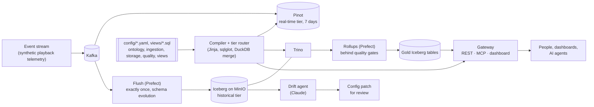

# Modular Agentic Lakehouse Engine

A config-driven semantic lakehouse. You define metrics once, in YAML. The
engine answers them from **Apache Pinot** (real-time) and **Apache Iceberg via
Trino** (historical), splitting and merging a query across the two when it
spans both, and serves the answers to dashboards and AI agents over **REST**
and **MCP**. Events arrive through **Kafka**, land in Iceberg exactly once,
and are rolled up into gold tables behind **data quality gates**. When
producers change their events, a **Claude-powered agent** proposes the
ontology changes as a reviewable patch.


## Highlights

- **One ontology, three engines.** Dimensions and metrics are defined once in
  [`config/ontology.yaml`](config/ontology.yaml). A dbt-style Jinja compiler
  turns them into DuckDB, Trino or Pinot SQL. sqlglot parses every hand-written
  SQL fragment at load time, so a broken definition fails when the config
  loads, not in a query.
- **A router that knows where data lives.** Recent ranges go to Pinot, older
  ones to Trino, and a range that spans both is split and merged in DuckDB.
  Every answer reports the time range it actually covers.
- **Exactly-once ingestion with schema evolution.** The flush stores its Kafka
  offsets in the same Iceberg commit as the rows. New event fields become new
  columns without anyone touching config.
- **Rollups behind quality gates.** Gold tables are materialized semantic
  queries. Their new rows must pass checks before they're published
  (write-audit-publish); otherwise the table keeps its last good contents.
- **An agent for schema drift.** When new fields appear, Claude proposes
  dimensions and metrics. A proposal has to pass the platform's own validation
  and run on real data before it is written as a git patch for a person to
  review.
- **Views in plain SQL.** Dashboards read named, parameterized views from
  `config/views/*.sql`. A view over an ontology model selects metrics by name
  and is routed across both tiers, so it is live to the second; a view over
  Iceberg tables is ordinary Trino SQL. Every view is checked against the
  config when it loads, so renaming a metric fails a test, not a dashboard.
- **Dashboards are HTML with live chart tags.** `<male-lines view="isp_hourly"
  x="hour" y="p99_ttfb" series="isp_provider">` draws a view and keeps it
  current: the server pushes a new result when the data changes, and everyone
  watching the same view shares one query. Labels and number formats come from
  the ontology, so the example dashboard is about 90 lines of HTML.
- **The same answers for people and agents.** A REST API, an MCP server for
  Claude Code or Claude Desktop, and a dashboard all go through one gateway, so
  they report the same numbers with the same caveats.

## Architecture



## Quick start

You need Docker with about 12 GB of memory for its VM and about 8 GB of disk
for images. On macOS, for example:
`colima start --cpu 6 --memory 12 --disk 30`.

```bash
docker compose -f docker/docker-compose.yml up -d --build
```

The first start takes a few minutes. Once the engines are healthy, `setup`
creates the topics and tables and publishes 24 hours of synthetic playback
telemetry, and a live stream keeps the data moving after that. The flush
moves events into Iceberg every 5 minutes, and the rollups follow within
another 5. From an empty machine, the API is up in about a minute.

| | |
|---|---|
| Dashboard | http://127.0.0.1:8000 |
| REST API docs | http://127.0.0.1:8000/docs |
| Prefect UI (pipelines, quality-gate results) | http://127.0.0.1:4200 |
| Pinot UI · Trino · MinIO console | http://127.0.0.1:9000 · `127.0.0.1:8080` · http://127.0.0.1:9101 |

**Ask questions from Claude Code.** The gateway is an MCP server:

```bash
claude mcp add --transport http lakehouse http://127.0.0.1:8000/mcp
```

Then ask something like *"Which ISP had the worst rebuffering over the last 6
hours, and can I trust the data right now?"* The agent can list the metrics
(`list_metrics`), query them (`query_metrics`), run the project's views
(`list_views`, `query_view`) and check freshness and quality gates
(`data_status`).

**Watch the drift agent.** Put `ANTHROPIC_API_KEY=...` in a `.env` file at the
repository root (it is git-ignored) and restart the `drift` service. Then
simulate an upstream release that adds two event fields:

```bash
docker compose -f docker/docker-compose.yml stop stream
docker compose -f docker/docker-compose.yml run --rm stream stream --add-field cdn_pop=string --add-field dropped_frames=double
```

Within one flush the fields become Iceberg columns. The next drift check, or
`docker compose -f docker/docker-compose.yml exec drift python run.py drift`,
writes a proposal that the dashboard lists. Apply it with
`git apply proposals/<file> && python run.py setup`.

## Start your own project

The engine in `core/` knows nothing about playback data. Everything specific
to the example lives in [`examples/playback/`](examples/playback/): its config,
its simulator and its dashboard. `config/` starts as a copy of that example,
and it is yours to change:

1. **Describe your events** in `config/ingestion.yaml`: a Kafka topic, columns
   and a time column per dataset.
2. **Define your metrics and dimensions** in `config/ontology.yaml`. They are
   YAML; you only write SQL for small expressions, like a `CASE` that turns a
   device name into a mobile flag.
3. **Optionally** add rollups to `config/storage.yaml`, their checks to
   `config/quality_rules.yaml`, views to `config/views/` and HTML dashboards
   to `config/dashboards/`.
4. **Run it:** `docker compose -f docker/docker-compose.yml up -d --build`.
   Setup creates the topics and tables, then publishes synthetic events with
   random values that fit your columns until your real producers write to
   Kafka. For realistic fake data, point the dataset's `simulator` at a
   function of your own, as the example does.

The tests always run against `examples/playback/config`, so your changes to
`config/` never break them.

## How it works

### One definition, many engines

A metric is declared once:

```yaml
- name: p99_ttfb
  description: 99th percentile Time-to-First-Byte latency (ms), measured on stream starts.
  agg: percentile
  percentile: 0.99
  sql: request_latency_ms
  filters:
    - "stream_start_event = true"
```

and compiled for each engine. Each engine's dialect lives in one Jinja macro
file ([`core/templates/macros/`](core/templates/macros/)) that overrides only
what differs from standard SQL:

```sql
-- DuckDB
quantile_cont(request_latency_ms, 0.99) FILTER (WHERE stream_start_event = TRUE)
-- Trino
approx_percentile(CAST(request_latency_ms AS DOUBLE), 0.99) FILTER (WHERE stream_start_event = TRUE)
-- Pinot
PERCENTILETDIGEST("request_latency_ms", 99) FILTER (WHERE "stream_start_event" = TRUE)
```

Hand-written SQL in the ontology is parsed with sqlglot and printed in each
engine's syntax. Fragments that would behave differently across engines are
rejected, for example integer division (`//`), which DuckDB truncates and
Trino rounds. Filter values sent by clients are built as escaped literals,
never pasted into SQL as text.

### Routing across tiers

Pinot keeps the last 7 days. Iceberg holds everything up to the flush
**watermark**, which the flush records in the same commit as the data.

| The query's time range | Answered by |
|---|---|
| inside Pinot's retention | Pinot |
| ends before the watermark | Trino over Iceberg |
| spans both, with a time grain | split at a bucket boundary: each bucket comes from one tier, so every metric is exact |
| spans both, only counts / sums / averages / ratios | each tier returns partial aggregates (an average becomes a sum and a count), merged in DuckDB |
| spans both, with percentiles or distinct counts | Trino up to the watermark, with a note in the result that the newest data isn't included |

Results always carry the range they cover, the SQL each tier ran, and notes,
so neither a person nor an agent mistakes a partial answer for a complete one.

### Ingestion: exactly once, schema-tolerant

[`core/flush.py`](core/flush.py) reads every message published before it
started and appends the events to Iceberg. The same Iceberg commit records the
Kafka offsets it read up to and the new watermark, so a crash can neither load
a batch twice nor skip one. A new field becomes an optional column with an
inferred type; a field that stops arriving is stored as NULL, in Iceberg and in
Pinot alike.

### Rollups and quality gates

A rollup ([`config/storage.yaml`](config/storage.yaml)) is a semantic query
kept as a gold Iceberg table. Each run recomputes a window that ends at the
last complete time bucket before the watermark and starts where the previous
run stopped, reaching at least `lookback_hours` back so late events are
recounted. The new rows are checked against
[`config/quality_rules.yaml`](config/quality_rules.yaml) before they're
published: `row_count`, `not_null`, `unique`, `range`, `accepted_values`,
`expression` and `freshness`. An `error` check that fails blocks the publish;
a `warn` check is only reported. Results appear on the dashboard, in
`data_status`, and in the Prefect UI.

### Views

A view is a SQL file in [`config/views/`](config/views/): a YAML header, then
one SELECT. It is served at `GET /views/<name>?<params>` and over MCP.

```sql
/*
description: Playback quality per ISP over the last hour.
params:
  minutes: {type: int, default: 60, min: 5, max: 1440}
*/
SELECT isp_provider, rebuffer_incidence_rate, p99_ttfb
FROM playback_telemetry
WHERE event_ts >= now() - INTERVAL :minutes MINUTE
ORDER BY rebuffer_incidence_rate DESC
```

What it reads decides how it runs:

- **From an ontology model** (above), the columns are metric and dimension
  names, so metric math stays in `ontology.yaml`. The view becomes a semantic
  query that the router answers from Pinot, Iceberg or both, so it includes
  events from seconds ago. `date_trunc('hour', event_ts)` groups by time, and
  WHERE bounds the time dimension (`>=` and `<`) and filters dimensions.
- **From Iceberg tables** (`gold.hourly_isp_quality`, `raw.telemetry`), it is
  any SELECT, run on Trino as written. Its data ends at each table's last flush
  or rollup run, which the response reports as `data_through`.

Parameters are typed, checked (`min`, `max`, `values`) and bound as SQL
literals, never pasted in as text. A parameter with `default: null` is
optional, and a condition on it is dropped while it has no value ("all ISPs").
Each view is checked when the platform loads: one SELECT, known models,
tables and columns. Its result columns are known up front.

**Live views.** `GET /views/<name>/live?<params>` is a Server-Sent Events
stream ([`core/live.py`](core/live.py)): the view's result now, then again each
time it changes, and an `error` event if a refresh fails (the last result
still stands). Everyone watching a view with the same parameters shares one
feed, which runs only while someone watches. A view over a model reruns every
10 seconds (or its header's `refresh_seconds`), since the real-time tier never
stops changing; a view over tables reruns when a flush or rollup commits to
one of its tables. Either way, a result is pushed only if it changed. A
dashboard watches all its views over one connection,
`GET /live?view=isp_now&view=isp_hourly%3Fhours%3D24`, since browsers allow
only about six open connections to a server.

### Dashboards

A dashboard is an HTML file in [`config/dashboards/`](config/dashboards/),
served at `/d/<name>`. It loads [`/male.js`](core/static/male.js) and draws
views with tags:

```html
<script type="module" src="/male.js"></script>

<male-kpi view="quality_overall" value="p99_ttfb" compare="from_minutes_ago=120&amp;to_minutes_ago=60"></male-kpi>
<male-bars view="isp_now" category="isp_provider" value="rebuffer_incidence_rate" highlight="first"></male-bars>
<male-param name="hours" options="24=24 h,48=48 h,168=7 days" value="48"></male-param>
<male-lines view="isp_hourly" x="hour" y="p99_ttfb" series="isp_provider"></male-lines>
```

Every tag is live: the page keeps one connection to `/live` and redraws a
chart when its view's result changes. Labels, number formats and which way is
better (for coloring a change) come from the ontology, so a tag rarely needs
more than names. A `<male-param>` sets a page parameter that fills every view
parameter of the same name, and the URL keeps it, so a link reopens the same
state. Charts use one validated palette, keep an entity's color on every chart
of the page, and come with a table view, a keyboard crosshair, and light and
dark themes. `<male-freshness>`, `<male-gates>` and `<male-drift>` show the
platform's own status. Custom code reads the same live data with
`import { subscribe } from "/male.js"`. The full list of tags is at the top of
[`male.js`](core/static/male.js), and the example's
[dashboard](examples/playback/config/dashboards/playback.html) uses most of them.

### The drift agent

[`core/agent_sync.py`](core/agent_sync.py) compares the live Iceberg schema
with `ingestion.yaml` and profiles any new columns from sampled rows. It adds
the columns to `ingestion.yaml` itself, then asks Claude (Opus 5.5, structured
output) which columns deserve dimensions or metrics. The patched config must
pass the platform's validation, and every proposed dimension and metric must
compile and run on DuckDB over the sampled rows. Failures go back to Claude,
up to three attempts. The result is a patch in `proposals/` that keeps the
YAML's comments and formatting. Config is never edited in place, and a drift
that already has a pending patch isn't proposed (or paid for) again.

## Configuration

| File | What it defines |
|---|---|
| [`ontology.yaml`](config/ontology.yaml) | models, dimensions and metrics: what the data means |
| [`ingestion.yaml`](config/ingestion.yaml) | each dataset's Kafka topic, raw schema and Pinot table |
| [`storage.yaml`](config/storage.yaml) | Iceberg tables, flush schedule and lateness, rollups |
| [`quality_rules.yaml`](config/quality_rules.yaml) | the checks each rollup must pass |
| [`deployment.yaml`](config/deployment.yaml) | service endpoints (a container-network version lives in `docker/config/`) |
| `views/*.sql` | named queries that dashboards and agents read, at `/views/<name>` |
| `dashboards/*.html` | dashboards, served at `/d/<name>` (and at `/` when there is just one) |

All of it is strictly validated (unknown keys are errors) and checked against
the rest when it loads. For example, every column a metric reads must exist in
its dataset, and every column a view reads must exist in its model or table.

## Development

```bash
python3.13 -m venv .venv && .venv/bin/pip install -e ".[dev]"
.venv/bin/pytest                    # unit tests: no Docker needed
.venv/bin/pytest -m integration     # against the running stack
```

`run.py` drives each component directly against the same stack: `setup`,
`seed`, `stream`, `flush`, `rollups`, `drift`, `serve`, `mcp` (stdio, for
Claude Desktop) and `reset --yes`. The tests use the example project in
`examples/playback/config`; the integration tests expect the stack to be
running it, as `config/` does by default. Stop the matching container first if you
run one on the host, for example `docker compose -f docker/docker-compose.yml
stop stream`.

```
config/            your project: YAML config, views/ and dashboards/ (starts as a copy of the example)
core/              the engine: compiler, router, engines, flush, rollups, quality,
                   drift agent, gateway, synthetic events (simulate.py)
  templates/       the query skeleton and one macro file per engine
examples/playback/ the reference project: config/ (with views and a dashboard), simulator.py
pipelines/         Prefect flows: flush, rollups, drift check
docker/            docker-compose.yml, Trino catalog, container deployment config
tests/             unit tests; tests/integration/ runs against the stack
```

## How it's tested

- **Cross-engine agreement.** The same semantic queries run on DuckDB, Trino
  and Pinot over identical events, and the answers must match, including
  answers the router splits across tiers.
- **Approximate percentiles checked by rank.** Pinot's t-digest and Trino's
  `approx_percentile` promise accuracy in rank, not in value. In small groups,
  correct answers can differ from the exact one by more than 10% in
  milliseconds. The tests count how many raw values sit below each answer
  instead.
- **Golden SQL.** The SQL generated for each engine is pinned in
  [`tests/golden/`](tests/golden/), so dialect changes show up as reviewable
  diffs.
- **No live calls to Claude in tests.** The drift agent's tests drive the real
  Anthropic SDK over a mocked HTTP transport.
- **Independent review.** A separate review pass found 12 bugs, including a
  double count at the split millisecond and Pinot storing missing fields as 0.
  Each was reproduced with a failing test before it was fixed.

## Limitations

- Percentiles and distinct counts over a range that spans both tiers are
  answered up to the last flush. Mergeable sketches (e.g. KLL, HLL) would lift
  this.
- A query reads one model at a time; there are no joins across models.
- The stack is set up for local use: the credentials are placeholders, and the
  API has no authentication.
